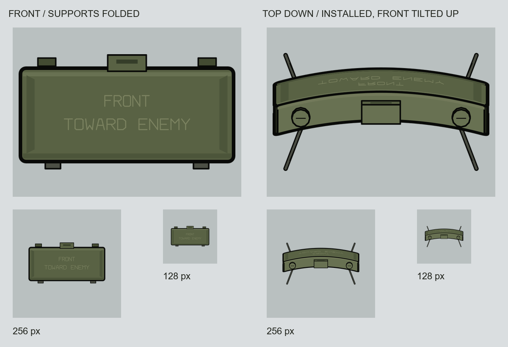

# M18A1 SVG 텍스처 초안

2026-11-10. 사용자가 요청한 두 상태를 편집용 SVG와 투명 PNG로 제작했다.



| 파일 | 표현 |
|---|---|
| `Output/HD_M18A1_Item.svg` · `.png` | 정면. 두 쌍의 지지 다리를 본체 뒤로 접은 상태로 해석했다. 앞에서는 아래쪽 경첩만 드러나고 긴 다리는 나오지 않는다. |
| `Output/HD_M18A1_Deployed.svg` · `.png` | 위에서 수직으로 내려다본 설치 상태. 전면은 화면 위쪽을 향하며 살짝 위를 향하도록 기울였다. 펼친 다리 네 가닥, 휘어진 본체의 전면과 윗면이 구분된다. |

모든 원본 캔버스는 투명 1024×1024다. 각 PNG에는 전체 캔버스를 줄인 `_256.png`, `_128.png`도 함께 있다. 미리보기의 회색 배경과 영문 상태 표시는 비교판에만 들어 있다.

## 형상·표현의 근거

- 로컬 외형 자료: `../.texture/ref/claymore-mine-m18-m18a1/source/Clay.obj`와 `textures/ClayMore_Base_Color.png`. 휘어진 직사각형 본체, 위쪽 두 캡과 중앙 돌출부, 아래쪽 경첩과 두 쌍의 다리를 참고했다. 원본 파일은 수정하지 않았다.
- `Reference/`의 이미지는 해당 OBJ에 색상 텍스처를 연결해 확인한 참고 렌더다. 원래 OBJ의 다리는 펼쳐져 있다. 접은 상태는 이 원본의 접힘 애니메이션을 재현한 것이 아니라 본체 뒤로 접힌 외관을 SVG로 그린 해석이다.
- 최종 그림은 3D 렌더를 붙여 넣지 않고, 간략화한 외피의 투영을 SVG 경로로 구성했다. 기존 총기·M167·곡사포에서 관찰한 단색 면 명암과 검은 외곽선을 적용했다. 그라데이션·사진 잡음·외부 이미지·글꼴 의존성은 없다.
- 전면의 `FRONT / TOWARD ENEMY` 표식은 물건에 새겨진 외형 요소로 SVG 경로에 넣었다. 별도의 게임 UI나 설명문을 추가한 것은 아니다. 설치형에서는 실제 투영 방향에 따라 압축되어 보인다.
- 본체 외곽은 1024 기준 중앙 정렬 12px 선으로 시작했다. 긴 다리는 검은 테두리와 어두운 금속 면을 겹쳐 그렸다. 이는 이 초안의 표현 수치이며 기존 총기의 16px 레이어 효과와 같은 설정이라고 주장하지 않는다.

## 편집 구조

SVG 안에서 `folded-rear-supports` / `deployed-supports`, `hinges`, `housing`, `molded-front-marking`, `upper-caps-and-sight`를 분리했다. 설치형의 기울기는 시각적 자세를 정하는 드로잉 파라미터다. 물리 시뮬레이션이나 게임 내 폭발 방향 계산은 추가하지 않았다.

`build_m18a1.py`가 형상·팔레트·투영·내보내기를 관리한다. Pillow와 SVG를 지원하는 ImageMagick이 설치된 환경에서 실행한다.

```powershell
python ArtSource/M18A1/build_m18a1.py
```

참고 렌더를 다시 만들려면 Blender에서 다음 스크립트를 실행한다. 이 렌더는 최종 SVG/PNG 생성에 필요하지 않다.

```powershell
blender --background --python ArtSource/M18A1/render_reference.py
```

## 확인한 항목

- 두 SVG가 XML로 정상 파싱되고, 래스터 이미지·텍스트 객체·필터·그라데이션 없이 경로로 구성됨을 확인했다.
- SVG를 실제 PNG로 렌더했다. 1024×1024 크기, 투명 배경, 완전 불투명한 본체, 캔버스 안쪽 여백을 검사했다.
- 물체를 크게 배치한 비교와 전체 캔버스를 256·128px로 줄인 비교판을 열어 곡면 경계, 다리의 가림, 설치형의 전면 방향을 확인했다.
- `validation.json`에 출력 경계 상자·경로 수·참고 원본 SHA-256을 기록했다.
- 현재 산출물은 아트 초안이다. 게임 Def 연결과 크리타 가져오기·저장·재열기는 아직 수행하지 않았다.
