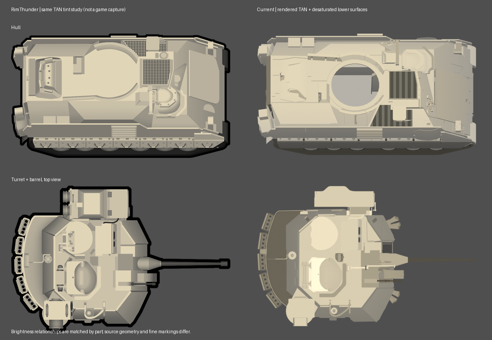

# RimThunder 부품 팔레트 적용과 손잡이 수정

현재 모델: 51,995면·103개 메시. 이번에는 형상·분리·피벗·애니메이션을 바꾸지 않고 채색을 수정했다.

## 손잡이 위치

밝게 할 대상은 `WT_hatch_02`의 뚜껑 위를 가로지르는 넓은 아치형 부품(원본 연결 영역 1, 268면)이다.
뒤쪽 원통형 힌지와 작은 끝 받침은 별도 밝기 강조를 제거했다. 디버그 이미지 `hatch_regions.png`의 주황색 부품이 이번 강조 대상이며 뒤쪽 회색 원통은 힌지다.
해치와 힌지의 일반 높이 명도는 그대로 적용한다.

## RimThunder 대응

로컬 Workshop `3724793908/Textures/Vehicles/M2A3/`의 `vehicle_east.png`, `vehicle_turret_full.png`를 확인했다.
원본은 무채색 명도와 색상 마스크를 쓰는 텍스처다. 부품 위치를 대조한 20개 영역의 불투명 픽셀 중앙값을 `../../rimthunder_palette_samples.json`에 저장했다.
파일 SHA256·측정 사각형·10/90 분위값을 함께 기록했다. `sample_locations_*.png`는 위치 확인용 검사 이미지다.

| 대응 영역 | 측정 무채색 중앙값(0~255) |
|---|---:|
| 차체 지붕 / 측면 벽 | 255 / 147 |
| 포탑 지붕 / 정면 경사 / 측면 경사 | 233 / 160 / 149 |
| TOW 덮개 / 본체의 밝은 면 | 233 / 255 |
| 주포 방패 / 포신 | 198 / 92.5 |
| 곡면 해치 / 후방 바구니 바닥 | 약 221 / 189 |

곡면 해치 샘플은 `hatch_02`, 평평한 해치의 밝은 기준은 `hatch_03`에 대응한다.
`../../rimthunder_paint.py`가 대응 부품·면 방향을 명도값에 연결하고 TAN(225,213,183)을 적용한다.
이전 임의 갈색 팔레트와 3배/4배 차이 확대 경로는 제거했다. 연속 높이·곡률은 셰이더에서 보간하고 기본색은 4단계(8비트 기준) 간격으로 공유해 재질 수가 불필요하게 늘지 않게 했다.
기존 요청을 유지하는 예외는 밝은 아치 손잡이(246,234,204), 밝은 후방 지붕 해치, 인접 경사보다 어두운 후방 바닥이다.

## 채도

부품의 윗면 기준 대비 방향 때문에 어두워진 색은 명도를 유지하며 채도를 낮춘다.
실제 높이와 곡률로 어두워진 부분도 `Height saturation` 코너 속성으로 채도를 추가로 낮춘다.
고유 부품색과 의도적인 홈 강조는 각각 별도 역할/속성으로 유지한다. 같은 명도를 주는 재질 전체를 회색으로 바꾸는 방식은 아니다.

## 비교와 검증

`rimthunder_color_comparison.png`는 차체끼리, 포탑+포신끼리 각각 화면 폭 490px로 맞췄다.
왼쪽은 무채색 레퍼런스에 같은 TAN을 적용한 비교용 색상 연구이며 실제 게임 캡처가 아니다. 오른쪽은 실제 모델 렌더다.
형상·세부 표식 차이는 남아 있다. 이 비교는 부품별 명도·팔레트 확인용이다.

`after_front.png`, `after_rear.png`에서 실제 아치 손잡이의 밝기와 힌지 구분, 주포 색 연속성, 낮은 면의 회색 TAN을 확인했다.
저장 모델에서 268면 손잡이의 위치와 강조 색, 방향/높이 음영의 채도 감소, RimThunder 부품값 적용, 기존 형상·연막탄·4개 애니메이션을 검증했다.
256px/512px EAST를 갱신했다. 실제 게임 내 검수는 미실시다.

재생성: `sample_rimthunder_palette.py` → 기존 모델 빌드/검증/렌더 → 저해상도 출력 → `compare_rimthunder_palette.py`.
확대 뷰는 Blender에서 `render_palette_closeup.py`를 실행한다. 수치 팔레트는 재측정 없이도 빌드에 사용할 수 있다.
