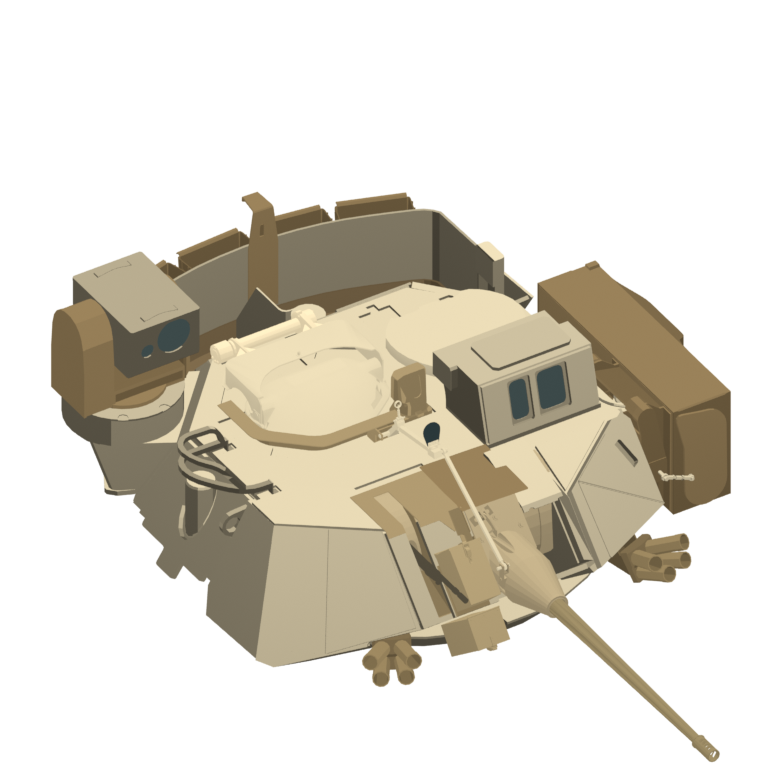
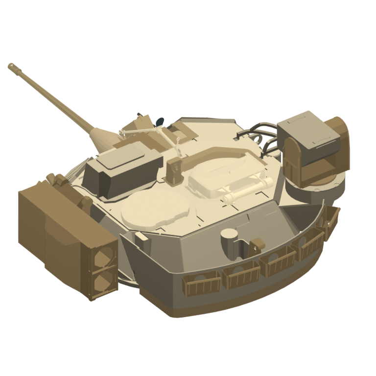

# 포탑 연결부·연막탄·표면 채색 수정

원본 OBJ와 현재 포탑을 앞/뒤 확대 뷰로 대조했다. 직전의 두 연결봉 복구만으로는 상위 메시 안의 받침대와 전방 덮개가 빠진 상태였다.
연막탄 8개도 별도 그룹이 아니라 `bone_turret` 안의 연결 요소로 존재했다. 현재는 실제 원본 면 위치를 사용한다.

## 복구

- 전체 원본 그룹: `roll_01/02/03/06/07`, `ex_decor_02/03`, `bone_gun`, `gun_barrel`, `hatch_02`.
- 포탑 내부 그룹: 받침/브래킷 6개, 연막탄 발사관 8개, 장착대 구성 요소 6개.
- 부품별 원본 면 인덱스·범위·이름은 `../../turret_restoration.json`에 고정했다. 원본 파일 SHA256은 `../../ReferenceFit/manifest.json`으로 검증한다.
- 복구한 영역의 기존 감량 잔여 면 319개를 제거했다. 원본 받침의 면적 0인 면 #8407 하나는 복구에서 제외했다.
- 이전 평판 덮개를 유지한다. 전체 51,995면·103개 메시이며 차체와 모든 기존 부모/피벗을 보존한다.

## 채색

- 주포/포신/전방 덮개의 기본색을 실제 면 방향에서 다시 계산해 같은 평면의 삼각형별 색 불일치를 없앴다.
- 밝은 해치 02 후방 연결봉·힌지·끝 받침, 더 어두운 장비 TAN, 인접 경사보다 어두운 후방 바구니 안쪽 바닥을 적용했다.
- 오목한 모서리에서 이어진 작은 표면을 의도적으로 어둡게 칠한다. 그림자/AO가 아닌 페인트다.
- 곡면 해치와 포신은 자동 홈 마스크에서 제외하고, 단독 삼각형도 제외해 어두운 삼각형 얼룩을 방지했다.
- 높이와 곡률에 따른 명도 보간, 약한 카메라 깊이 보정, 투명 배경과 무광원 렌더를 유지했다.

## 시각 대조

`before_front.png`, `before_rear.png`는 수정 직전 상태다. `source_front.png`, `source_rear.png`는 원본 부품 확인용 무채색 렌더로 내부 구조도 보인다.
`after_front.png`, `after_rear.png`는 최종 채색 결과다. 같은 확대 카메라와 스케일을 사용했다.

## 검증

원본 부품의 모든 유효 면 위치, 원래 부모·피벗, 변경 범위, 연막탄 수, 주포 평면 기본색,
밝은 해치 연결부·어두운 후방 바닥·홈 채색을 검증했다. 면적 0 면이 없는 저장 모델과 4개 애니메이션도 통과했다.
256px/512px EAST와 앞/뒤 등각 뷰를 확인했다. 실제 게임 내 검수는 미실시다.

확대 결과 재생성은 Blender에서 `../inspect_turret_followup.py -- --after`를 사용한다.
옵션 없이 실행하면 수정 전/원본 검사 이미지를 새로 생성하므로 현재 보관된 before 기록을 덮어쓰게 된다.
