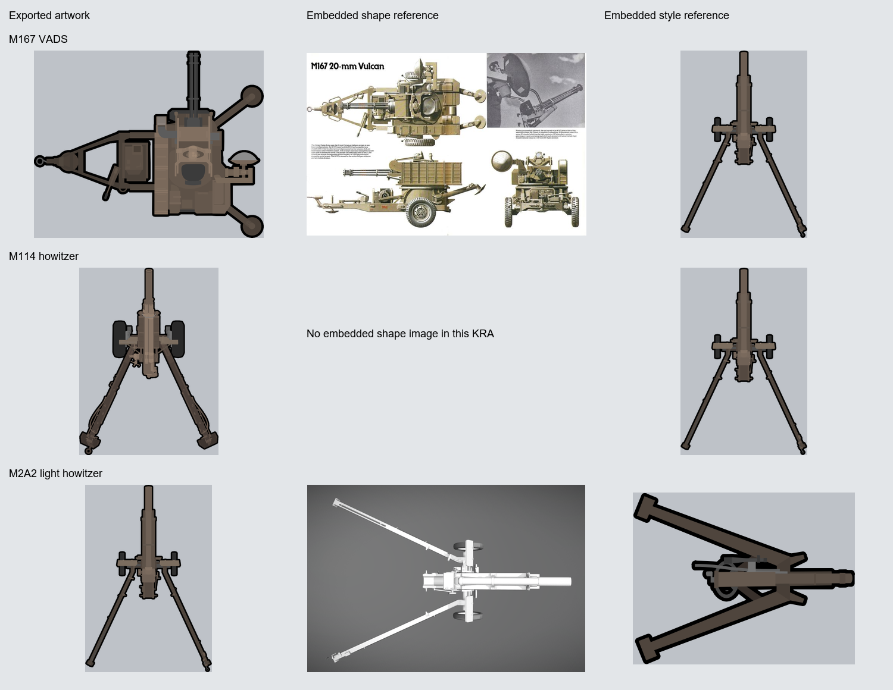
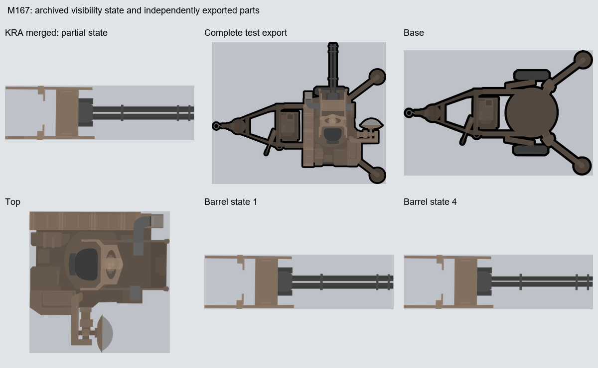

# M167·곡사포 원본의 SVG 제작 방식

2026-11-10. 사용자가 총기와 비슷한 방식으로 만들었다고 알려준 M167·곡사포 원본을 추가 조사했다. 대상은 `../.texture/HD_M167VADS_UI.kra`, `HD_M114Howitzer_.kra`, `HD_M2A2LightHowitzer.kra`다. 최초의 '자주포' 표현은 사용자 정정에 따라 곡사포로 기록한다. 기존 그림과 레퍼런스를 읽는 조사이며 새 모델·텍스처를 만들거나 현재 차량 아트 규칙을 바꾸는 작업은 아니다.

## 포함된 레퍼런스



| 원본 | 캔버스 | 벡터 레이어 | 참고 이미지 | ASL 외곽선 크기 필드 |
|---|---:|---:|---|---:|
| M167 VADS | 1024×1024 | 100개, 이 중 빈 SVG 1개 | 여러 방향의 M167 장비 그림·사진을 모은 판 1개, 포 스프라이트 1개 | 9px, 3개 효과 기록 |
| M114 곡사포 | 1024×1024 | 15개 | 포 스프라이트 1개 | 7px |
| M2A2 경곡사포 | 1024×1024 | 20개 | 흰색 3D 모델의 상면 렌더 1개, 단순화한 곡사포 스프라이트 1개 | 8px, 3개 효과 기록 |

벡터 레이어 수는 숨긴 대안·복제본도 포함한 문서 전체의 수다. 최종 그림을 이루는 고유 부품 수나 동시에 표시되는 레이어 수가 아니다.

- **M167:** `reference_images/1.png`는 'M167 20-mm Vulcan' 표제와 여러 방향의 장비 그림·사진을 포함한다. 형상·장비 배치의 근거로 볼 수 있다. `reference_images/0.png`의 단색 포 스프라이트는 외곽선·면 채색·생략 수준을 비교하는 자료다. 저장 당시 형상 판의 불투명도는 0, 스타일 스프라이트는 1이다.
- **M114:** 현재 `.kra`에 포함된 참고 이미지는 M167에도 들어 있는 포 스프라이트다. 해당 파일에는 M114 실물 사진이나 도면이 포함되지 않았다. 이것만으로 제작 당시 다른 형상 자료를 보지 않았다고 결론내리지는 않는다. 별도 `HD_155MMM114_UI.kra`에도 같은 참고 스프라이트가 들어 있다.
- **M2A2:** `reference_images/0.png`는 포신·차륜·벌어진 두 포가 다리의 위치를 볼 수 있는 흰색 3D 상면 렌더다. `reference_images/1.png`는 외곽선이 굵고 색 면이 단순한 곡사포 스프라이트다. 저장 당시 렌더의 불투명도는 0, 스타일 스프라이트는 1이다. 이미지가 포함되어 있다는 사실과 최종 형상의 정확한 모델/형식 일치는 구분한다.

참고 스프라이트의 외부 작품명·제작자와 렌더의 원본 3D 파일은 내장 이미지 조사만으로 확정하지 않았다.

## 총기와 이어지는 제작 방식

**형상 자료와 스타일 스프라이트를 함께 두고, 여러 SVG 레이어로 부품과 면 명암을 그린다.** 총기 원본에서 관찰한 방식이 포병 장비에서도 확인된다.

- 세 파일의 비어 있지 않은 내장 SVG에는 선형·방사형 그라데이션이 없다. 도색은 갈색·회갈색의 여러 단색 면으로, 고무·포신 금속·홈은 별도의 회색·암색으로 구분한다.
- 넓은 본체와 포신의 밝고 어두운 띠, 손잡이·단차·볼트·홈의 배치가 덩어리를 설명한다. 모든 작은 부품을 동일하게 지우거나 모든 경계에 같은 검은 선을 추가하는 방식은 아니다.
- M2A2 레이어에는 `본체`, `리코일 세트`, `손잡이들`, `-76도 조준기 손잡이`, `좌우 손잡이`, `상하 손잡이` 같은 이름이 있다. 그림 한 장 안에서도 움직임·역할별 편집 단위가 유지되어 있다.
- 굵은 외곽선에는 그룹의 크리타 레이어 효과가 쓰인다. 내장 `content.svg`만 따로 꺼내는 것과 최종 PNG의 외곽선을 재현하는 것은 별도 작업이다.

## 총기와 다른 점: 상면·부품 분리·가동 상태

총기 첫 시험의 '총구 오른쪽 수평 측면도'를 이 장비들에 그대로 적용하지 않는다. 비교판에는 위에서 본 장비가 쓰이며, UI용 완성 출력은 포신을 위로 향하게 배치한 예도 있다. 먼저 각 출력의 방향·피벗을 확인해야 한다.

| 장비 | 확인한 분리 PNG |
|---|---|
| M167 | `Base`, `Top`, `1Barrel`–`4Barrel`, 상부·각 포신 상태의 `OutLine` |
| M114 | `Base`, `Barrel`, `Chamber`, `TopUnder`, `TopTop`, `Lever1`, `Lever2`, 각 가동 부품의 `Outline`, `UI` |
| M2A2 | `Base`, `Body`, `Barrel`, `Lever1`–`Lever3`, 각 가동 부품의 `OutLine`, `UI` |

이들 PNG의 캔버스는 모두 1024×1024다. 분리 부품은 캔버스 안의 좌표를 보존한다. 각 부품을 경계 상자로 잘라 개별 중앙에 배치하면 그대로 합성할 수 없게 된다.

M167의 네 `Barrel` 파일은 모두 같은 알파 경계 상자 `(509, 457)–(896, 569)`를 가지지만 그림 내용은 상태별로 다르다. 파일명과 네 상태의 존재는 확인했으며, 이 조사에서는 게임 코드의 재생 순서·속도를 검증하지 않았다.

### 저장된 M167 미리보기는 부분 표시 상태



`HD_M167VADS_UI.kra`의 `mergedimage.png`에는 포신을 포함한 일부 부품만 보인다. 문서 안에는 큰 그룹들이 숨김 상태로 남아 있다. 이 미리보기만 보고 받침·바퀴·상부가 그려지지 않았다고 판단하면 안 된다.

위 그림의 전체 장비는 별도의 `HD_M167VADS_Test.png`다. 현재 저장소에 적용된 완성 합성본이라고 부르지 않고, 원본 폴더에 남은 시험용 출력으로 구분한다. 받침·상부·포신도 각각의 PNG로 남아 있다.

## 외곽선 수치: 설정과 출력 픽셀을 함께 본다

M167·M114·M2A2는 1024 캔버스지만 크리타 외곽선 설정 필드는 각각 9·7·8px다. 소총 M16/M4의 16px을 포병 장비에도 일괄 적용하면 현재 그림보다 두꺼워진다.

기본 PNG와 대응 Outline PNG의 알파 경계 상자를 대조하면 다음 확장량이 나온다. 이 값은 외곽선이 가장 바깥에서 차지한 범위이지, 모든 위치의 정확한 선폭을 뜻하지 않는다.

| 장비 | 비교한 기본/Outline 쌍 | 왼쪽·위·오른쪽·아래 경계 확장 |
|---|---:|---|
| M167 | 5쌍 | 각 8px |
| M114 | 6쌍 | 각 6px |
| M2A2 | 5쌍 | 각 7px |

따라서 SVG 시험에서는 설정값뿐 아니라 같은 물체 크기로 맞춘 출력의 윤곽과 내부 빈 공간을 대조한다. 총기·포병·차량 전체에 하나의 절대 선폭을 강제하지 않는다.

## 첫 총기 SVG 기준에 반영할 점

1. 실물 사진·도면·3D 렌더는 형상과 위치의 근거로, 스타일 스프라이트는 채색과 외곽선의 근거로 구분한다.
2. SVG 그룹은 임의로 합치지 않고 부품·재질·명암 역할을 알아볼 수 있게 나눈다. 장비의 가동 부품은 나중에 독립 출력할 수 있는 경계를 유지한다.
3. 검은 선은 전체 외곽과 내부 면 경계를 구분해 설계한다. 분리 부품을 합성하는 장비라면 각 부품의 윤곽과 가림 순서를 확인한다.
4. 소총 시험의 16px은 M16 계열을 재현하기 위한 시작점으로 유지한다. 포병의 더 얇은 설정을 근거로 현재 소총 기준을 임의 변경하지 않는다.
5. 이 조사에서 관찰한 단색 면 표현을 현재 Bradley 등 별도 차량의 큰 곡면 규칙에 확대 적용하지 않는다. 해당 차량 작업에는 기존 `ArtSource/VEHICLE_ART_STYLE.md`와 사용자 결정을 따른다.

## 검증과 재실행

```powershell
python ArtSource/WeaponSVGStudy/audit_artillery_sources.py --source-root ../.texture
```

`Review/artillery_audit.json`에 원본 해시·참고 이미지 속성·벡터 통계·레이어 효과 크기 필드, 대응 PNG 비교와 외곽선 경계 확장량을 기록했다.

- `.kra` 3개의 조사 전후 SHA-256이 같음을 검사했다.
- `Textures/Buildings/Security`에서 대응되는 PNG 37개가 `.texture`의 출력과 RGBA 픽셀 단위로 일치했다.
- 기본/Outline 16쌍의 경계 상자를 비교했다.
- 비교판을 열어 형상 자료·스타일 스프라이트·부분 표시 상태를 직접 확인했다.
- 새 SVG 생성·크리타 가져오기·게임 내 애니메이션은 이번 조사 범위에 포함하지 않았다.
