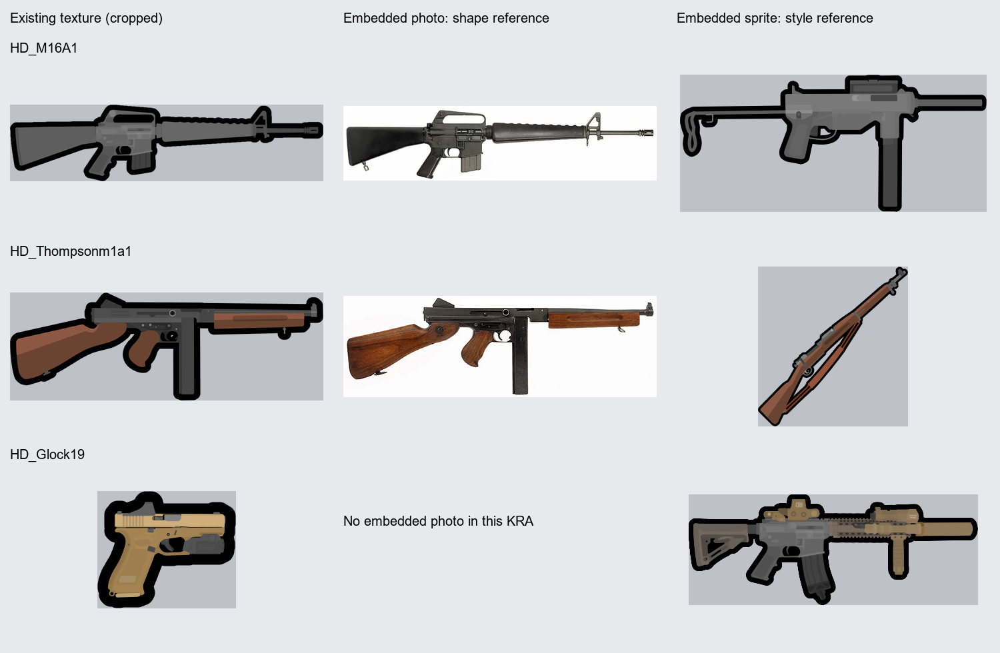
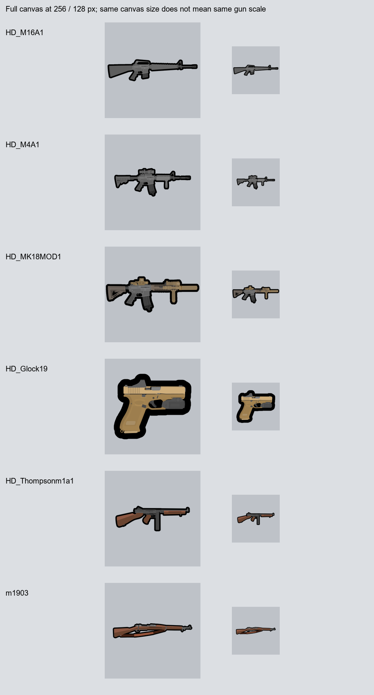

# SVG 총기 텍스처 시험 기준

2026-11-10. 기존 원본을 조사해 정한 첫 시험의 제안 기준이다. 사용자가 승인한 공통 규칙이나 모든 총기에 적용할 확정 규격은 아니다. 이번 단계에서는 새 총기 그림과 게임 교체 파일을 만들지 않는다.

## 조사 대상과 근거

원본 위치는 저장소 옆 `../.texture`다. `.kra`를 ZIP으로 읽어 `maindoc.xml`, `reference_images/*.png`, 벡터 레이어의 `content.svg`, `mergedimage.png`, 레이어 효과를 확인했다. 원본은 수정하지 않았다.

| 원본 | 캔버스 | 포함된 참고 이미지 | 벡터 레이어 수 | 완성 그림의 알파 경계 상자 |
|---|---:|---:|---:|---|
| `HD_M16A1.kra` | 1024×1024 | 3 | 5 | (30, 394)–(994, 630) |
| `HD_M16A4.kra` | 1024×1024 | 2 | 5 | (23, 354)–(1002, 671) |
| `HD_M4A1.kra` | 1024×1024 | 3 | 6 | (102, 358)–(923, 665) |
| `HD_MK18MOD1.kra` | 768×768 | 4 | 12 | (9, 238)–(759, 529) |
| `HD_Glock19.kra` | 256×256 | 1 | 4 | (24, 40)–(232, 216) |
| `HD_m1911.kra` | 256×256 | 2 | 5 | (11, 47)–(246, 209) |
| `HD_Thompsonm1a1.kra` | 1024×1024 | 2 | 10 | (114, 374)–(911, 648) |
| `m1903.kra` | 1280×1280 | 2 | 6 | (107, 539)–(1171, 741) |
| `K2.kra` | 1024×1024 | 1 | 2 | (35, 364)–(989, 660) |

좌표는 왼쪽 위가 원점이며 오른쪽·아래쪽 끝을 포함하지 않는 픽셀 범위다. 그림 크기를 비교할 때는 캔버스와 경계 상자를 함께 본다.



### 참고 이미지가 맡는 역할

- **형상 근거:** M16A1의 `reference_images/2.png`는 해당 총기의 측면 사진이다. Thompson의 `reference_images/0.png`도 실물 측면 사진이다. 총몸·총열·개머리판의 길이와 위치, 주요 부품의 식별에 쓴다.
- **표현 근거:** M16A1·M16A4·M4에 공통으로 들어 있는 짧은 총기 스프라이트, Thompson·M1903에 들어 있는 목재 소총 스프라이트는 외곽선·색 면·생략 수준을 비교하는 자료다. 외부 작품명이나 제작자는 원본 내부 자료만으로 확정하지 않는다.
- **연결된 스타일 참고:** MK18에는 기존 M4 스프라이트가, Glock19에는 MK18 스프라이트가 들어 있다. Glock19의 이 파일에는 실물 Glock 사진이 없으므로 형상까지 MK18에서 가져왔다고 해석하지 않는다.
- **다른 모델 사진의 한계:** M16 계열과 MK18에 반복되는 `reference_images/0.png`는 고정식 개머리판·긴 총열을 가진 소총 사진이다. M16A1이나 MK18의 정확한 형식·부품 구성을 확정하는 근거로 그대로 쓰지 않는다.
- 참고 이미지 중에는 저장 당시 `opacity="0"`인 것도 있다. 숨겨져 있다는 이유로 버리지 않고, 포함된 자료와 현재 표시 상태를 구분한다.

## 관찰한 표현 방식

1. **시점과 방향:** 완성 그림은 개머리판이 왼쪽, 총구가 오른쪽인 수평 측면도다. 사선으로 배치된 참고 스프라이트도 있지만 최종 그림 방향과 동일시하지 않는다.
2. **윤곽:** 검은 외곽선이 굵고 모서리는 대체로 둥글다. 방아쇠울·개머리판 내부의 빈 공간도 실루엣을 읽는 데 중요하다. 모든 내부 부품에 같은 굵기의 검은 선을 두르지는 않는다.
3. **명암과 재질:** 조사한 9개 원본의 내장 SVG에는 선형·방사형 그라데이션이 없다. 금속은 주로 무채색의 여러 단색 면으로, 목재·황갈색 부품은 같은 계열의 밝고 어두운 면으로 나뉜다. 사진의 반사·나뭇결·표면 잡음을 그대로 재현하지 않는다. 이는 내장 SVG의 관찰값이며 모든 래스터 레이어의 표현을 단정하는 말은 아니다.
4. **디테일:** 총몸의 큰 단차, 배출구·조작부, 탄창의 홈, 핸드가드의 대표적인 구멍·리브는 남긴다. 원본 M4에는 작은 핀과 반복 디테일도 있으므로 '작은 부품을 모두 삭제'하는 규칙은 세우지 않는다.
5. **팔레트:** M16/M4 원본의 색 예로 `#262626`, `#393939`, `#4e4e4e`, `#646464`, `#6f6f6f`, `#7f7f7f`가 있다. 역할에 따라 고르는 출발색이며 각 부품에 일괄 적용할 고정 명도 사다리는 아니다. Thompson의 목재에는 `#6a4430`, `#8d5843`이 쓰인다.
6. **이미 벡터로 제작된 원본:** 이들 총기는 단순한 PNG 그림만 남은 자료가 아니다. 여러 SVG 레이어로 나뉘어 있어 윤곽과 색 면을 직접 참고할 수 있다.

### 외곽선 수치와 SVG 추출 주의점

M16A1·M16A4·M4·MK18·Glock19·K2의 ASL 레이어 효과에서 외곽선 크기 필드 `Sz / #Pxl`은 모두 16이다. 효과가 있는 그룹·레이어와 SVG 본체는 별개다. 예를 들어 M16A1 SVG의 경로들은 `stroke-width="0"`이고 완성 PNG에는 굵은 검은 외곽선이 있다. **내장 SVG 하나를 그대로 추출하는 것만으로 완성 그림의 외곽선이 재현되지는 않는다.**

같은 16px이라도 1024 캔버스를 256으로 축소하면 약 4px, 768 캔버스라면 약 5.33px, 256 캔버스라면 16px에 해당한다. 이는 효과 설정의 단순 배율 환산이며 래스터 결과의 모든 위치에서 두께가 정확히 같다는 뜻은 아니다. 따라서 Glock의 16px을 새 1024 소총에 적용하는 방식으로 통일하지 않는다.



축소 비교는 전체 정사각 캔버스를 각각 256·128px로 줄여 배치했다. 총기만 경계 상자로 잘라 같은 길이로 키운 비교가 아니다. 실제 게임 표시 크기는 `drawSize`와 배치에 따라 달라지며, 이 이미지는 게임 내 검증을 대신하지 않는다.

## 첫 SVG 시험에 적용할 제안

| 항목 | 첫 시험 기준 | 확인 방법 |
|---|---|---|
| 비교 대상 | M16A1을 우선 후보로 삼는다. 해당 형식 사진과 기존 벡터 원본이 함께 있고 M4보다 부착물·반복 디테일이 적다. | 새 그림과 기존 M16A1을 같은 총기 길이로 비교한다. |
| 캔버스·배치 | 투명 1024×1024, 총구 오른쪽, 수평 측면. M16A1을 그릴 경우 기존 경계 상자와 중심을 출발점으로 삼는다. | 캔버스 내 위치와 총열 축을 겹쳐 확인한다. 다른 총기까지 같은 길이로 강제하지 않는다. |
| 형상 | 해당 모델 사진에서 총열·총몸·탄창·개머리판의 비율과 주요 윤곽을 잡는다. | 긴 총열과 삼각형 핸드가드, 고정식 개머리판, 캐링핸들 등의 식별 요소를 대조한다. |
| 외곽선 | 1024 기준 바깥쪽 약 16px를 출발점으로 한다. 하나의 완성 실루엣과 구멍을 먼저 만든다. | 256 축소에서 약 4px 수준의 외곽 인상을 기존 M16A1과 비교한다. |
| SVG 구조 | `silhouette` → 재질별 본체 → 면 명암 → 식별 디테일을 의미 있는 그룹으로 나눈다. | 그룹 숨김·수정이 가능하고 외곽선이 내부 접합선마다 중복되지 않아야 한다. |
| 채색 | 무채색 금속·수지의 단색 면부터 시작하고 필요한 부위만 밝기 차이를 준다. | 사진 반사와 잡음을 복사하지 않으면서 기존 회색 총몸·어두운 탄창/손잡이 관계를 유지한다. |
| 축소 검수 | 1024 원본, 256·128 전체 캔버스 축소, 같은 총기 길이 비교를 모두 본다. | 방아쇠울·캐링핸들 구멍이 막히지 않고 탄창·손잡이·총열이 구분되는지 확인한다. |
| 최종 파일 | 편집용 SVG와 투명 PNG 시험본을 분리한다. 이번 기준 조사에서는 아직 생성하지 않는다. | 크리타 호환성은 실제 가져오기·저장·재열기를 수행한 뒤 판정한다. |

## 검증과 재실행

`audit_sources.py`는 원본 아카이브를 읽기 전용으로 열고 다음 결과를 만든다. Pillow가 설치된 Python이 필요하다.

```powershell
python ArtSource/WeaponSVGStudy/audit_sources.py --source-root ../.texture
```

- `Review/audit.json`: 원본 SHA-256, 캔버스·경계 상자, 참고 이미지의 크기·변환·표시 상태, 벡터/레이어 통계, 색, 외곽선 설정 필드.
- `Review/reference_comparison.png`: 포함 자료를 직접 보고 분류한 형상·스타일 비교.
- `Review/reduction_review.png`: 전체 캔버스 축소 검수.

9개 원본의 조사 전후 SHA-256이 같음을 검사했다. 대응 파일을 찾은 8개는 `mergedimage.png`와 저장소의 완성 텍스처를 RGBA 픽셀 단위로 비교해 일치했다. K2는 이 조사에서 대응 게임 PNG를 지정하지 않았다. 새 SVG의 렌더, 크리타 가져오기·저장·재열기, 게임 내 표시는 아직 시험하지 않았다.
