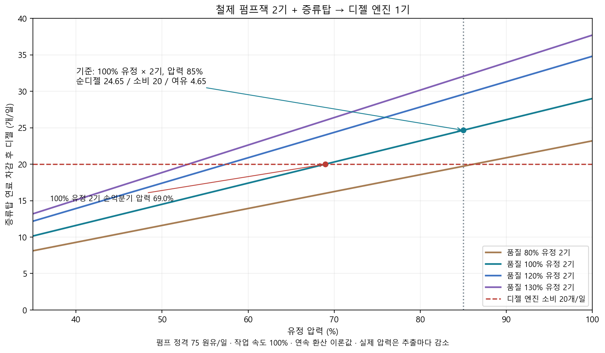

# 유정 품질·철제 펌프·디젤 엔진 리밸런싱

2026-11-03. 사용자 지정 기준은 **품질 100% 유정 2개, 압력 85%, 철제 펌프잭 2기와 증류탑 1기로 산업용 디젤 엔진 1기를 계속 운용**하는 것이다. 압력은 기준값에 고정하지 않고 기존 추출 감소 규칙을 유지한다.

## 적용값

| 대상 | 이전 | 변경 |
|---|---:|---:|
| 케이블식 굴착기 유정 품질 | 75~125% | **75~80%** |
| 로터리 시추기 유정 품질 | 100~150% | **100~130%** |
| 철제 펌프잭 정격 생산량 | 100 원유/일 | **75 원유/일** |
| 산업용 디젤 엔진 연료 | 40 디젤/일 | **20 디젤/일** |

요청에서 상한만 바꾼 두 시추기는 기존 품질 하한을 유지한다. 철제 펌프의 전력 1,800 W, 엔진의 정격 축출력 8,000 W·최대 10,000 W, 연료통 80개, 증류탑 산출 비율은 유지한다. 엔진 연료통은 연속 4일분이다. 추출 배치량이 75개가 되며 정격 주기는 1일이다. 새로 개발하는 유정에 품질 범위를 적용한다.

## 기준 조건의 일일 수지

| 항목 | 계산 | 수량/일 |
|---|---|---:|
| 원유 추출 | 75 × 2 × 품질 1.00 × 압력 0.85 | **127.5** |
| 디젤 총산출 | 원유 100당 20 | 25.5 |
| 증류탑 자체 디젤 | 원유 100당 2/3 | −0.85 |
| 엔진에 공급 가능한 디젤 | 총산출 − 증류탑 소비 | **24.65** |
| 엔진 소비 | 하루 연속 가동 | −20 |
| 남는 디젤 | 정제·엔진 소비 차감 | **4.65** |

공급은 엔진 소비보다 **23.25%** 많다. 생산·정제의 상대 가동률이 약 **81.14%** 이상이면 기준 압력에서 수지가 맞는다. 이 가동률은 추출과 처리량을 같은 비율로 줄여 보는 이론 환산이며, 배치 대기나 재보충으로 생기는 순간 공백을 없애지는 않는다. 시작 디젤과 재고 완충이 필요하다.

증류탑 기준 노동은 하루 2.04 게임시간이다(작업자 속도 100%·작업대 속도 150%). 100 원유당 화학연료 45·나프타 10·등유 15·디젤 20과 가동 중 10 디젤/일을 그대로 쓴다. 운반·수면·식사·정비 시간과 작업 후 전력 유예는 연속 수지에서 제외한다.

## 발전과 압력의 한계

두 펌프 3,600 W + 탑 가동 1,200 W = 최대 **4,800 W**다. 초기 산업 발전기 목표 4,800 W의 실제 효율 곡선상 축 입력은 약 **6,563.86 W**로, 디젤 엔진 정격 8,000 W 안에 들어온다. 실제 검증에서도 엔진 1대와 발전기 1대로 모두 공급했다. 다른 축·전력 설비를 더 붙이면 별도 부하 계산이 필요하다.

- 품질 100% 유정 두 기의 연료 손익분기 압력은 **68.97%**다. 그 아래에서 장기 연속 운전하려면 추가 원유·디젤 공급이나 압력 관리가 필요하다. 기준을 최저 압력 35%로 바꾸지 않았다.
- 압력 35%에서는 두 기가 순디젤 **10.15개/일**을 내므로 엔진 20개/일을 감당하지 못한다.
- 품질 80% 두 기·압력 85%는 순디젤 **19.72개/일**로 부족하다. 로터리 개발 유정과 케이블식 유정의 역할 차이를 남긴다.
- 가장 좋은 품질 130% 유정 한 기도 압력 85%에서는 순디젤 **16.02개/일**로 엔진 한 대를 연속 운전하지 못한다.

## 실제 1.7 검증

`.codex-staging/OilRebalance/actual-01`에서 **63 PASS·COMPLETE**, FAIL 없음. 새 정의를 로드한 뒤 실제 발전기 목표·부하·저장/불러오기를 확인하고, 품질 100%·압력 85%의 두 유정을 만드는 별도 연료 순환 검사를 실행했다.

- 실제 엔진·축망·발전기·전선·철제 펌프 2기·증류탑과 제작자·운반자 2명을 사용했다.
- 시동 연료는 엔진 80개·탑 50개만 넣었다. 원유와 느슨한 디젤은 공급하지 않았다. 시험 환경은 욕구를 유지하고 24시간 작업표를 쓰며, 야생동물·습격 등 외부 방해를 억제했다.
- 실제 게임 시계를 **480,000틱(8일)** 진행했다. 매 틱 엔진 연료와 두 펌프·탑 전력을 확인했고 한 번도 공급이 끊기지 않았다.
- 엔진 연료 소비 약 **159.79개**, 생산 디젤에 의한 자동 보충 **4회**, 엔진 최저 잔량 **31.65개**였다.
- 시동 후 계측 시작 시 총디젤 **129.88개 → 종료 142.23개**로 약 **12.35개 증가**했다. 압력은 **85% → 79%**로 실제 감소했다.
- 이 8일 실측은 배치 지연·노동·운반·재보충을 포함한다. 압력 85%의 하루 연속 환산 4.65개와 같은 수치로 강제하지 않는다. 이후 압력 69% 미만의 영구 자립을 입증한 것으로 해석하지 않는다.

[실제 8일 CSV](Data/StageI/oil_loop_actual.csv). 제품 빌드 경고·오류 0개. 게임 ERROR는 기존 Workshop 3781143823 폴더 부재뿐이며 새 석유·연료·저장 오류는 없었다.

## 재현

- `python Source/Analysis/StageI/oil_engine_balance.py`: 현재 XML의 산출·정제 연료·엔진 소비와 발전 효율에서 [20조건 비교 CSV](Data/StageI/oil_engine_balance.csv)·[수치/가정 JSON](Data/StageI/oil_engine_balance.json)·차트를 생성한다. 품질 범위, 75/일, 20/일, 기준 여유 20% 이상, 단일 고품질 유정의 부족, 발전 축입력 한계를 검사한다.
- `python Source/Analysis/StageI/oil_theory.py`: 기존 [80% 목제·120% 철제 30/90일 비교](I_Oil_Theory.md)를 현재 75 원유/일로 갱신한다.
- `python Source/Tests/OilMachinery/verify_definitions.py`, `dotnet run --project Source/Tests/OilMachinery/OilMachinery.Tests.csproj`: 품질·정격·연료·설명·리소스 연결과 시추 정비·완료·추출·전력 차단·압력 감소 회귀.
- `Source/Tests/PowerStageG/Start-Checks.ps1 -RuntimeRoot .codex-staging/OilRebalance/fresh-name -OilBalance`, 이후 `Source/Tests/Wait-Game17Host.ps1`로 동일 PID의 종료 로그 수집.
