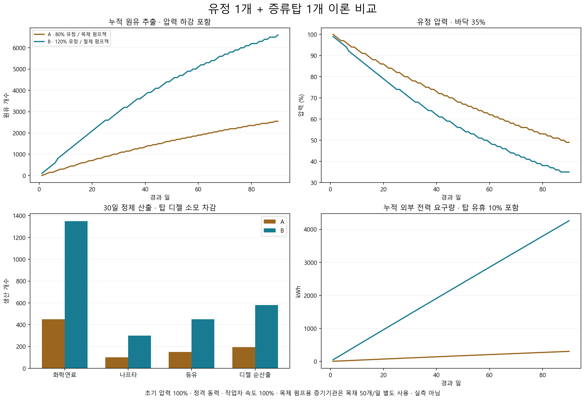

# 유정·펌프잭·증류탑 이론 비교

2026-11-03. I 그룹 T2-30의 첫 산출물이다. 사용자가 요청한 **80% 유정 + 목제 펌프잭**, **120% 유정 + 철제 펌프잭**을 각각 유정 1개·증류탑 1개로 비교한다. 생산량·가격·상단 재고 수치는 이번 분석에서 바꾸지 않는다.

## 계산 조건

- 1일 = 60,000틱. ‘유정 효율’은 `OilFieldRecord.quality` 0.8 / 1.2로 해석하고, 초기 압력은 두 경우 모두 100%다. 정격 RPM·충분한 전력·연료·출력 공간을 가정한다.
- 목제 펌프는 정격 50 원유/일, 철제 펌프는 100 원유/일이다. 실제 진행은 **정격 × 유정 품질 × 압력**이다. 한 배치마다 압력 1%p가 감소하고 35%에서 멈춘다. 압력 회복·증기 주입은 적용하지 않는다.
- 펌프는 제품과 같은 250틱 간격·float32 계산으로 모형화한다. 최초 rare tick을 250으로 두었다. 실제 게임의 건물별 rare tick 위상에 따른 오차는 별도다.
- 증류탑은 원유 100 → 화학연료 45 + 나프타 10 + 등유 15 + 디젤 20이다. 기본 노동 속도 100%, 작업대 속도 150%로 6,000 작업을 4,000틱(1.6 게임시간)에 처리한다. 운반·식사·수면·이동·고장·재보충 공백은 제외한다.
- 탑은 가동 1,200 W·유휴 120 W, 디젤은 가동시간에만 10개/일을 사용한다. 한 정제 배치의 디젤 소모는 2/3개다. 작업 후 전력 유예 90틱과 갱신 지연은 전력량에서 제외했으므로 표의 전력량은 이상 조건의 하한이다.
- 목제 펌프의 축동력 250 W는 소형 증기기관 하나가 단독 공급한다고 두었다. 기관을 계속 켜므로 목재 50개/일을 사용한다. 탑 전력은 별도 외부 공급이다. 철제 펌프는 계속 1,800 W를 요구하며 탑과 함께 외부 전원을 쓴다. **표의 전력량을 공급하는 발전기의 연료·건설비는 포함하지 않는다.**
- 정제 전 시동 디젤이 필요하다. 첫 배치에 최소 2/3 연료 단위가 필요하며, 실제 운반은 정수 아이템과 탱크 잔량으로 처리된다. 표의 디젤 소수는 탱크 연료까지 합친 등가 수량이다.

## 초기 압력을 유지할 때의 연속 환산 / 일

이 표는 배치 대기와 압력 하강 이전의 처리율이다. 첫날에 이 수량이 모두 정수 제품으로 나오는 뜻은 아니다.

| 항목 | A: 80% + 목제 | B: 120% + 철제 |
|---|---:|---:|
| 원유 | 40 | 120 |
| 화학연료 | 18 | 54 |
| 나프타 | 4 | 12 |
| 등유 | 6 | 18 |
| 디젤 총산출 | 8 | 24 |
| 증류탑 디젤 사용 | 0.267 | 0.8 |
| 디젤 순산출 | 7.733 | 23.2 |
| 목재 사용 | 50 | 0 |
| 축동력 | 250 W | 0 |
| 외부 전력 평균 | 148.8 W | 2,006.4 W |
| 외부 전력 최대 | 1,200 W | 3,000 W |
| 증류탑 작업시간 | 0.64시간 | 1.92시간 |

압력이 바닥 35%까지 내려가면 원유 처리율은 각각 **14 / 42개/일**이다. 탑의 정격 처리능력은 원유 1,500개/일이어서, 이 두 경우의 병목은 유정 추출과 공급 유지다.

## 압력 하강·정수 배치를 적용한 30일 누적

| 자원/수지 | A: 80% + 목제 | B: 120% + 철제 |
|---|---:|---:|
| 추출 원유 | 1,050 | 3,000 |
| 정제 완료 배치 | 10 | 30 |
| 남은 원유 | 50 | 0 |
| 화학연료 | 450 | 1,350 |
| 나프타 | 100 | 300 |
| 등유 | 150 | 450 |
| 디젤 총산출 | 200 | 600 |
| 탑 디젤 사용 | 6.667 | 20 |
| 디젤 순산출 | 193.333 | 580 |
| 목재 사용 | 1,500 | 0 |
| 탑 제작 노동 | 16시간 | 48시간 |
| 외부 전력 | 103.68 kWh | 1,434.24 kWh |
| 남은 압력 | 79% | 70% |
| 첫 원유 배치 | 약 1.254일 | 약 0.838일 |
| 첫 정제 완료 | 약 2.583일 | 약 0.904일 |

90일에는 원유 **2,550 / 6,600**, 화학연료 **1,125 / 2,970**, 등유 **375 / 990**, 디젤 순산출 **483.333 / 1,276**이다. 목재는 **4,500 / 0**, 외부 전력은 **302.4 / 4,261.248 kWh**다. 철제 안의 압력은 이 시점에 바닥 35%에 도달한다.

## 가격과 600 STL 사례를 읽는 방법

현재 기준가격은 화학연료 2.3·나프타 2·등유 1.4·디젤 1.6 은이다. 30일 순제품 기준가 합계는 A **1,754.33**, B **5,263 은**이며 여기에 목재·발전 연료·노동·수송비를 더 빼야 한다. 목재만 기준가 1.2로 평가해도 A는 1,800 은을 쓴다. 이를 하루 순수익이나 확정 현금 수입으로 부르지 않는다.

기존 후기와 같이 **화학연료와 등유만 판매**하고 상품 매각 계수를 예시로 0.7, STL 매입을 기존 5.25 은으로 두면 30일 누적 구매 가능한 지폐는 A **166 STL**, B **498 STL**이다. 전신 비용·상단 한도·정수 결제·다른 부산물·모든 운영비를 제외한 예시다. 이 조건의 600 STL은 목제 안에서 90일보다 오래 걸리고, 철제 안에서도 약 39일의 누적 산출을 팔아야 나오는 규모다. 상단 한 번에 600 STL을 받았다는 사실만으로 일일 수익이 과다하다고 판정할 수 없다.

따라서 현재 단계에서는 가격이나 생산량을 더 낮추지 않고 두 조합의 자원 수지를 비교한다. 다음 실측에서는 발전 방식·연료 조달·연구/건설 투자·운반/제작 노동과 실제 협상 가격을 지정해 순수익을 계산해야 한다.

## 재현 자료

- 생성기: `python Source/Analysis/StageI/oil_theory.py` (현재 모드 및 설치된 Core XML을 읽음).
- [90일 일별 CSV](Data/StageI/oil_daily.csv), [입력·가정 JSON](Data/StageI/oil_model.json), [SVG 차트](Data/StageI/oil_comparison.svg).
- 생성 중 초기 처리율 40/120, 탑 처리능력 1,500, 배치당 디젤 2/3, 전 기간 원유 수량 보존·압력 범위·단일 정제 작업 불변식을 검사한다. 차트의 한국어 글자·축·범례·각주를 렌더링 후 확인했다. 실제 게임 연속 운전 실측을 대체하지 않는다.
