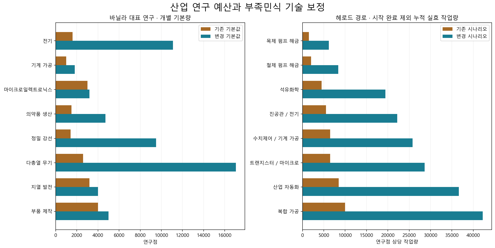

# 연구 예산·바닐라 비교·기술 단계 보정

> 2026-11-06: [중세 기준 재조정](Research_Medieval_Rebalance.md)으로 대체됐다. 아래는 이전 설계의 기록이다.

2026-11-03, T2-24. 실제 1.7.4995 rev309에서 로드된 연구 235개를 먼저 추출하고 비용을 설계했다. Core 바닐라 연구는 77개, 헤로드 연구는 66개다. 기존 헤로드 66개는 모두 Industrial이며 54개가 기본량 500이었다.

## 적용 원칙

1. **시대·핵심 생산·파생 장비를 구분한다.** 제철·기관·공작기계·전기·화학·반도체·자동화의 기반 예산을 높이고 전문 장비에는 더 작은 추가 예산을 둔다. 시작 완료 연구 3개는 기존 기본값을 유지했다. 헤로드 기본량 합계는 38,600 → 68,650이며 63개를 인상했다.
2. **같은 지식 묶음의 예산을 맞춘다.** 양방향 링크의 한쪽을 완료하면 반대쪽의 선행 연구까지 완료된다. 바닐라의 각 연결 연구는 자신의 선행 지식을 이미 가진 상태에서 추가로 얻는 헤로드 연구량을 비용으로 잡았다. 14개 연결 묶음 모두 같은 목표까지 누적 실효 작업량이 맞는다. 두 트리의 비용은 중복 합산하지 않는다.
3. **바닐라 핵심 기반도 인상한다.** 연결 연구 14개 외에 전력·자원 탐사·의료 시설·제작·후반 장비 24개를 조정했다. Core 77개 중 변경 38개, 기본량 합계 119,400 → 197,100이다. 전체 77개 전후 값은 CSV에 있다. DLC와 외부 모드의 기본량은 이번 표에서 인상하지 않았다.
4. **헤로드 시나리오에 부족민식 기술 페널티를 적용한다.** 엔진의 `ResearchProjectDef.CostFactor(Neolithic)`를 사용한다. 신석기 ×1, 중세 ×1.5, 산업 이후 ×2다. 실제 플레이어 세력은 Industrial을 유지한다. 다른 시나리오에는 이 추가 규칙이 없다. 바닐라 기본량 조정도 헤로드 시나리오에서만 적용한다. 값은 `Defs/Scenarios/ResearchBudgets_Helod.xml`에 두고, 현재 게임의 시나리오에 `HD_ResearchTechBaseline`이 있을 때만 `baseCost`에 반영한다. 다른 시나리오는 바닐라에서 읽은 기본량을 그대로 쓴다. 새 게임은 시나리오 지정 시점, 저장 게임은 시나리오를 읽은 직후에 다시 맞춘다. 헤로드 연구 66개의 기본량은 헤로드 트리 자체의 값이므로 시나리오와 무관하다.
5. 기존 전기 한 항목의 ×7 규칙과 그 때문에 필요했던 별도 완료 보정 코드를 제거했다. 새 규칙은 기본 게임의 기술 비용 계수 경로를 사용하므로 UI의 `CostApparent`, 정상 연구 진행, `FinishProject`와 즉시 완료가 같은 기준을 따른다.

전기의 기본량은 **1,600 → 11,100**이다. 헤로드 시나리오의 실제 작업량은 기존 **11,200(1,600×7) → 22,200(11,100×2)**다. 큰 기본값에는 헤로드 전기 이전의 기관·가공·전기 기반을 함께 부여하는 예산이 들어간다. 기존 숫자를 7배 한 뒤 다시 2배 하는 방식은 적용하지 않는다.

## 바닐라 연결 연구의 인상 근거

공통 선행 연구를 이미 완료한 뒤 추가로 받는 헤로드 연구의 기본량 합계다. 패키지마다 포함된 프로젝트 목록은 [정책 JSON](Data/StageI/research_policy.json)의 `linked.additional_projects`에 보존했다.

| 바닐라 연구 | 기존 기본량 | 변경 기본량 / 추가 지식 예산 |
|---|---:|---:|
| 전기 (`Electricity`) | 1600 | 11100 |
| 기계 가공 (`Machining`) | 1000 | 1800 |
| 냉방 (`AirConditioning`) | 500 | 700 |
| 마이크로일렉트로닉스 (`MicroelectronicsBasics`) | 3000 | 3200 |
| 약물 제조 (`DrugProduction`) | 500 | 700 |
| 의약품 생산 (`MedicineProduction`) | 1500 | 4700 |
| 멸균 소재 (`SterileMaterials`) | 600 | 6000 |
| 총포 제작 (`Gunsmithing`) | 500 | 3650 |
| 블로백 작동 (`BlowbackOperation`) | 500 | 1450 |
| 가스 작동 (`GasOperation`) | 1000 | 1650 |
| 정밀 강선 (`PrecisionRifling`) | 1400 | 9500 |
| 박격포 (`Mortars`) | 2000 | 8200 |
| 방탄복 (`FlakArmor`) | 1200 | 8600 |
| 다총열 무기 (`MultibarrelWeapons`) | 2600 | 17050 |

박격포·방탄복·다총열 무기의 인상 폭이 큰 이유도 현재 링크가 수치제어·화학·의료·소총 등 여러 선행 지식을 함께 부여하기 때문이다. 링크의 해금 범위는 유지하고 이에 대응하는 예산을 맞췄다.

## 누적 경로와 작업일 해석

시작 완료된 가구·의복·대장간·개척 정신·기계공학 기초·실험 분석을 제외했다. 아래 값은 헤로드 경로로 목표까지 연구하면서 공통 선행을 한 번씩 계산한 **연구점 상당 작업량**이다.

| 목표 | 기존 실효 작업량 | 변경 실효 작업량 | 속도 100%·24시간 연속 연구 시 변경 소요일 |
|---|---:|---:|---:|
| 철기 시대의 피 | 1500 | 6200 | 12.53일 |
| 깊은 곳 까지 | 2000 | 8400 | 16.97일 |
| 액체 연금술 | 4500 | 19400 | 39.19일 |
| 진공관의 시대 | 5500 | 22200 | 44.85일 |
| 수치제어 | 6500 | 25800 | 52.12일 |
| 실리콘 혁명 | 6500 | 28600 | 57.78일 |
| 산업 자동화 | 8500 | 36600 | 73.94일 |
| 복합 가공 | 10000 | 42200 | 85.25일 |

엔진의 정상 연구 진행식은 `입력 작업 × 0.00825 × 난이도 연구속도 / 기술 비용 계수`다. 속도·연구대·난이도의 곱을 1로 두면 24시간에 495점 상당의 작업을 한다. 표의 소요일은 이 정규화 기준이며 식사·수면·이동을 포함하지 않는다. 하루 8시간만 연구하면 3배, 속도 배수가 R이면 1/R로 환산한다. 연구대 요구 조건과 제작·건설·자원 확보 시간은 별도다.

이 수치는 여러 차례의 500점 클릭을 기반 시설의 장기 투자와 전문 장비의 후속 투자로 바꾸는 첫 조정값이다. 3차 테스트에서는 실제 연구자 수·능력·근무시간과 전기/석유화학/반도체 도달일을 기록해 재조정한다.

## 헤로드 전체 66개

| 연구 | 기본량 이전 → 변경 | 기존 HD 실효 작업량 → 변경 |
|---|---:|---:|
| 탄두 속의 공학 (`HelodAdvancedAmmunition`) | 1000 → 1400 | 1000 → 2800 |
| 고급 총기 광학장비 (`HelodAdvancedWeaponOptics`) | 1100 → 1600 | 1100 → 3200 |
| 강철의 장벽 (`HelodAntiAirMachineGun`) | 500 → 1200 | 500 → 2400 |
| 옴의 법칙 응용 (`HelodBasicElectronics`) | 500 → 1000 | 500 → 2000 |
| 통제된 폭발 (`HelodBasicEngine`) | 500 → 1400 | 500 → 2800 |
| 악마의 페인트붓 (`HelodBasicMachineGun`) | 500 → 800 | 500 → 1600 |
| 기계를 만드는 기계 (`HelodBasicMachineTool`) | 500 → 1000 | 500 → 2000 |
| 소총수의 세기 (`HelodBasicModernRifle`) | 500 → 850 | 500 → 1700 |
| 운동-전기 시너지 (`HelodBasicMotor`) | 500 → 1200 | 500 → 2400 |
| 철기 시대의 피 (`HelodBasicOilDevelopment`) | 500 → 900 | 500 → 1800 |
| 액체 연금술 (`HelodBasicPetrochemistry`) | 500 → 1200 | 500 → 2400 |
| 초토화 치료법 (`HelodBlisterAgent`) | 500 → 700 | 500 → 1400 |
| 완성된 소총 (`HelodBoltAction`) | 500 → 650 | 500 → 1300 |
| 약실의 혁명 (`HelodBreechLoadingGun`) | 500 → 700 | 500 → 1400 |
| 독가스의 바람 (`HelodChokingAgent`) | 500 → 650 | 500 → 1300 |
| 더 나은 삶 (`HelodColdWarTech`) | 500 → 1500 | 500 → 3000 |
| 시행착오와 리트머스 (`HelodExperimentalAnalysis`) | 500 → 500 | 500 → 1000 |
| 죽음을 미루는 기술 (`HelodFirstAid`) | 500 → 600 | 500 → 1200 |
| 첫 번째 방호층 (`HelodFlakJacket`) | 500 → 900 | 500 → 1800 |
| 개척정신 (`HelodFrontierSpirit`) | 100 → 100 | 100 → 200 |
| 생활의 기술 (`HelodGreatWarTech`) | 500 → 1200 | 500 → 2400 |
| 공기에서 빵을 (`HelodHaberBosch`) | 500 → 1600 | 500 → 3200 |
| 열을 훔치는 장치 (`HelodHeatPump`) | 500 → 700 | 500 → 1400 |
| 성숙한 제식소총 (`HelodHighAutomaticRifle`) | 500 → 1100 | 500 → 2200 |
| 진공관의 시대 (`HelodHighElectronics`) | 500 → 1500 | 500 → 3000 |
| 폭압과 천둥 (`HelodHighExplosive`) | 500 → 1000 | 500 → 2000 |
| 탄막 지대 (`HelodHighMachineGun`) | 500 → 800 | 500 → 1600 |
| 깊은 곳 까지 (`HelodHighOilDevelopment`) | 500 → 1100 | 500 → 2200 |
| 산업 자동화 (`HelodIndustrialAutomation`) | 1000 → 2200 | 1000 → 4400 |
| 자연의 정수 (`HelodIngredientExtraction`) | 500 → 700 | 500 → 1400 |
| 기계의 뼈대 (`HelodIronMaking`) | 500 → 1000 | 500 → 2000 |
| 포효하는 실린더 (`HelodLargeSteamEngine`) | 500 → 900 | 500 → 1800 |
| 레이저 표적지시 (`HelodLaserTargetDesignators`) | 1300 → 1800 | 1300 → 3600 |
| 화학적 제압 (`HelodLessLethalChemical`) | 500 → 700 | 500 → 1400 |
| 방패와 진압봉 (`HelodLessLethalClose`) | 500 → 600 | 500 → 1200 |
| 절제된 대응 (`HelodLessLethalLowRanged`) | 500 → 650 | 500 → 1300 |
| 서부를 개척한 총 (`HelodLeverAction`) | 500 → 600 | 500 → 1200 |
| 하나의 동력, 수많은 기계 (`HelodLineShaft`) | 500 → 1000 | 500 → 2000 |
| 사격과 기동 (`HelodLowAutomaticRifle`) | 500 → 900 | 500 → 1800 |
| 손에 든 포병 (`HelodLowGranade`) | 500 → 600 | 500 → 1200 |
| 듣고 들려라 (`HelodLowHeadSet`) | 500 → 700 | 500 → 1400 |
| 중탄도학 (`HelodLowHeavyArtillery`) | 500 → 1200 | 500 → 2400 |
| 분해식 포대 (`HelodLowLightArtillery`) | 500 → 900 | 500 → 1800 |
| 한 발의 포병 (`HelodLowVelocityGrenades`) | 700 → 800 | 700 → 1600 |
| 기계공학 입문 (`HelodMechanicalEngineering`) | 500 → 500 | 500 → 1000 |
| 천분의 일 인치를 향하여 (`HelodMetalCuttingMachine`) | 500 → 1000 | 500 → 2000 |
| 압력의 예술 (`HelodMetalFormingMachine`) | 500 → 1000 | 500 → 2000 |
| 제식소총 (`HelodMidAutomaticRifle`) | 500 → 1000 | 500 → 2000 |
| 현대식 섬광탄 (`HelodModernDiversionaryGrenades`) | 900 → 1000 | 900 → 2000 |
| 현대식 공격 수류탄 (`HelodModernOffensiveGrenades`) | 1100 → 1200 | 1100 → 2400 |
| 복합 가공 (`HelodMultiTaskMachining`) | 1500 → 2800 | 1500 → 5600 |
| 수치제어 (`HelodNumericalControl`) | 1000 → 1800 | 1000 → 3600 |
| 현대 방탄 장비 (`HelodPASGT`) | 500 → 1200 | 500 → 2400 |
| 병 속의 번개 (`HelodPrimaryCell`) | 500 → 600 | 500 → 1200 |
| 방아쇠 너머의 손 (`HelodRemoteWeaponControl`) | 1000 → 1600 | 1000 → 3200 |
| 전몰자를 위한 찬가 (`HelodRespectForPatrioticMartyrs`) | 500 → 600 | 500 → 1200 |
| 한 번 당기면 한 발 (`HelodSamiAutomaticPistol`) | 500 → 650 | 500 → 1300 |
| 맑은 하늘, 죽음의 지평선 (`HelodSmokeLessGunpowder`) | 500 → 1000 | 500 → 2000 |
| 서브 MOA 정밀도 (`HelodSniperRifle`) | 500 → 700 | 500 → 1400 |
| 특수전 화기 (`HelodSpecialOperationsWeapons`) | 900 → 1100 | 900 → 2200 |
| 불을 길들이다 (`HelodSteamEngine`) | 500 → 1200 | 500 → 2400 |
| 빅토리아 시대의 인터넷 (`HelodTelegraph`) | 500 → 600 | 500 → 1200 |
| 분자 조립 라인 (`HelodTotalSynthesisMedicine`) | 500 → 1200 | 500 → 2400 |
| 실리콘 혁명 (`HelodTransistor`) | 500 → 2200 | 500 → 4400 |
| 조준선 유지 (`HelodWireGuidedMissile`) | 500 → 1600 | 500 → 3200 |
| 전선의 속박을 끊고 (`HelodWireless`) | 500 → 1000 | 500 → 2000 |

## 바닐라 기본량 변경 38개

| 연구 | 기본량 이전 → 변경 | 기존 HD 실효 작업량 → 변경 |
|---|---:|---:|
| advanced fabrication (`AdvancedFabrication`) | 4000 → 6000 | 4000 → 12000 |
| 냉방 (`AirConditioning`) | 500 → 700 | 500 → 1400 |
| autodoor (`Autodoors`) | 600 → 800 | 600 → 1600 |
| battery (`Batteries`) | 400 → 700 | 400 → 1400 |
| biofuel refining (`BiofuelRefining`) | 700 → 1000 | 700 → 2000 |
| bionic replacements (`Bionics`) | 2000 → 3000 | 2000 → 6000 |
| 블로백 작동 (`BlowbackOperation`) | 500 → 1450 | 500 → 2900 |
| pulse-charged munitions (`ChargedShot`) | 3000 → 4000 | 3000 → 8000 |
| deep drilling (`DeepDrilling`) | 1000 → 1800 | 1000 → 3600 |
| 약물 제조 (`DrugProduction`) | 500 → 700 | 500 → 1400 |
| 전기 (`Electricity`) | 1600 → 11100 | 11200 → 22200 |
| fabrication (`Fabrication`) | 4000 → 5000 | 4000 → 10000 |
| 방탄복 (`FlakArmor`) | 1200 → 8600 | 1200 → 17200 |
| 가스 작동 (`GasOperation`) | 1000 → 1650 | 1000 → 3300 |
| geothermal power (`GeothermalPower`) | 3200 → 4000 | 3200 → 8000 |
| ground-penetrating scanner (`GroundPenetratingScanner`) | 1000 → 2000 | 1000 → 4000 |
| 총포 제작 (`Gunsmithing`) | 500 → 3650 | 500 → 7300 |
| gun turrets (`GunTurrets`) | 500 → 800 | 500 → 1600 |
| autocannon turret (`HeavyTurrets`) | 1600 → 2200 | 1600 → 4400 |
| hospital bed (`HospitalBed`) | 1200 → 1600 | 1200 → 3200 |
| hydroponics (`Hydroponics`) | 700 → 1000 | 700 → 2000 |
| IEDs (`IEDs`) | 500 → 800 | 500 → 1600 |
| long-range mineral scanner (`LongRangeMineralScanner`) | 2000 → 3000 | 2000 → 6000 |
| 기계 가공 (`Machining`) | 1000 → 1800 | 1000 → 3600 |
| 의약품 생산 (`MedicineProduction`) | 1500 → 4700 | 1500 → 9400 |
| 마이크로일렉트로닉스 (`MicroelectronicsBasics`) | 3000 → 3200 | 3000 → 6400 |
| moisture pump (`MoisturePump`) | 1200 → 1500 | 1200 → 3000 |
| 박격포 (`Mortars`) | 2000 → 8200 | 2000 → 16400 |
| multi-analyzer (`MultiAnalyzer`) | 4000 → 5000 | 4000 → 10000 |
| 다총열 무기 (`MultibarrelWeapons`) | 2600 → 17050 | 2600 → 34100 |
| marine armor (`PoweredArmor`) | 6000 → 8000 | 6000 → 16000 |
| 정밀 강선 (`PrecisionRifling`) | 1400 → 9500 | 1400 → 19000 |
| recon armor (`ReconArmor`) | 6000 → 7000 | 6000 → 14000 |
| shields (`ShieldBelt`) | 1000 → 1500 | 1000 → 3000 |
| solar panel (`SolarPanels`) | 600 → 1000 | 600 → 2000 |
| 멸균 소재 (`SterileMaterials`) | 600 → 6000 | 600 → 12000 |
| transport pod (`TransportPod`) | 1000 → 1500 | 1000 → 3000 |
| watermill generator (`WatermillGenerator`) | 700 → 1000 | 700 → 2000 |

변경하지 않은 바닐라 39개를 포함한 [전체 143행 비교 CSV](Data/StageI/research_comparison.csv), [변경 전 실제 정의](Data/StageI/research_before.json), [변경 후 실제 정의](Data/StageI/research_after.json), [14개 동등 경로와 누적 경로](Data/StageI/research_routes.json)를 함께 제공한다.

## 검증

- `python Source/Analysis/StageI/research_balance.py --check`: 현재 XML·Core 패치·실제 로드 결과 143행, 14개 양방향 동등 경로를 대조한다. 그래프는 수치와 한국어·축·범례를 렌더 후 확인했다.
- `.codex-staging/StageI/research-01/Evidence/checks.txt`: **323 PASS, COMPLETE, FAIL 없음**. 변경 기본량 101개(헤로드 63·바닐라 38), 연구점 프로젝트 전체의 부족민 기술 계수, 다른 시나리오 범위, 실제 세력 기술 보존, 정상 연구의 절반 진행·완료, 꽉 찬 표시 진행도, 양방향 해금, 즉시 전체 완료, 실제 연구 탭 열기, 시나리오 저장/로드 1회 적용과 현금 회귀를 확인했다.
- `dotnet run --project Source/Tests/LinkedResearch/LinkedResearch.Tests.csproj`: **1,245개** 연동 검사 통과. 수치제어의 비용 기대값을 새 1,800점 예산으로 갱신했다.
- `Source/Verify-RecipePlacement.ps1`: 86개 명시 조합법·533개 구체 ThingDef의 연구·작업대 연결을 통과했다.
- 최종 게임 ERROR는 기존 Workshop 폴더 부재 3781143823뿐이며 새로운 연구·저장 오류는 없다. 정상 연구 검증은 실제 `ResearchPerformed` API로 진행했으며, 표의 수십 일 동안 연구자를 노동 AI로 연속 운전한 실측과 구분한다. 이전 저장의 전기 ×7 규칙 이행은 제공하지 않는다.
