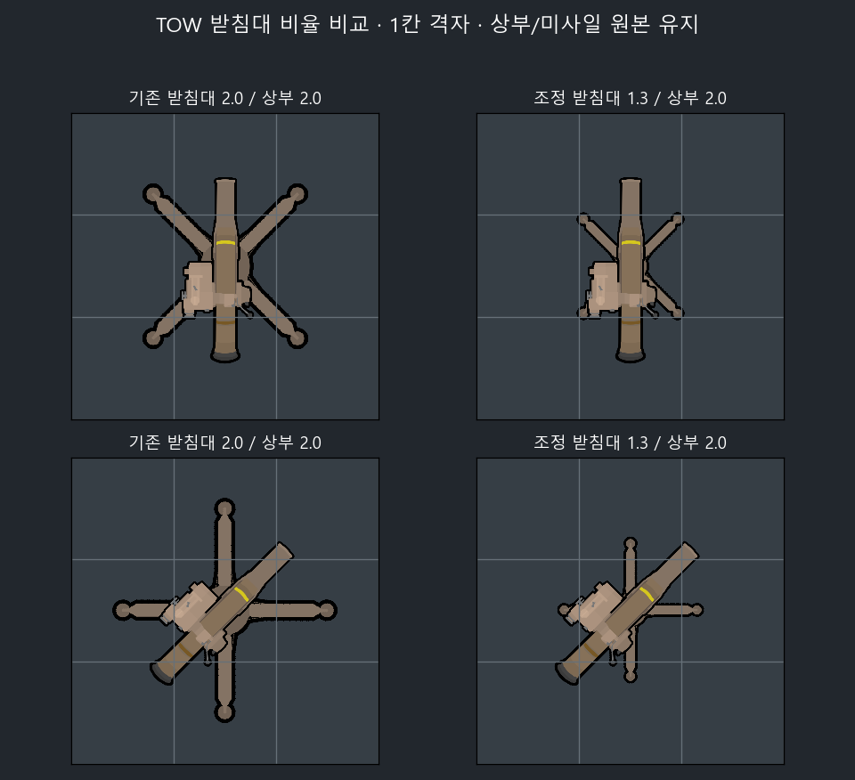

# 지원화기 건설 재료

2026-11-05 적용.

## M167 VADS

기존 탄소강 530·범용 기계 부품 30·프레스 부품 16·균일 압연 강판 8에 **축 6·기초 전기 부품 16·기초 전자 부품 8**을 추가했다. 회전 구동부·배선·초기 전자 조준 장치를 전용 중간재로 표현한다. 추가 재료의 생산 연구는 `HelodAntiAirMachineGun`의 기존 선행 경로에 있어 별도 연구 조건을 추가하지 않았다.

XML 대조로 비용 외의 수치·연구·혼합탄·그래픽 정의 보존을 확인했고 전체 레시피 배치 검사를 통과했다.

## M220 TOW

기존 발사대에는 `HelodWireGuidedMissile` 연구만 있고 건설 재료·작업량·건설 메뉴 지정이 없었다. 무기 제작대에서 제작하는 미사일과 별개로, **헤로드 건설 메뉴에서 설치하는 건물**의 경로를 완성했다.

| 재료 | 수량 |
| --- | --- |
| 탄소강 | 80 |
| 범용 기계 부품 | 8 |
| 프레스 부품 | 4 |
| 기초 전기 부품 | 8 |
| 전자 부품 | 6 |

건설 기술 6, 작업량 5000. 연구·설치 면적 1×1·발사 및 재장전 동작·성능은 유지한다. 재료 생산 연구는 기존 선행 경로에서 확보할 수 있다.

### 하부 받침대 비율

하부 `HD_TOWBase`는 기본 `TurretTop.DrawTurret`가 그리며, 별도 컴포넌트가 발사관과 장전 미사일을 겹쳐 그린다. `building.turretTopDrawSize`만 **기본 2.0 → 1.3(65%)**으로 설정했다. 상부 `CompProperties_TowLauncherGraphic.drawSize`는 **2.0 유지**. 원본 이미지·피벗·회전·장전 레이어는 바꾸지 않았다.

위 이미지는 XML 크기로 구성한 비교 도표이며 게임 스크린샷은 아니다.

## 실제 게임 검증

RimWorld 1.7.4995 rev309의 `-SupportWeapons` 검사에서 **43 PASS / COMPLETE**를 확인했다. M167·TOW 모두 연구 후 건설 메뉴 노출, 청사진 생성, 실제 자재 운반·프레임 작업·건설 완료, 재료별 정확한 소비를 검사했다. TOW는 장전/비장전 × 5개 각도에서 실제 그리기 행렬의 하부 크기 1.3과 상부/미사일 크기 2.0, 레이어 수 2/4를 확인했다.

첫 실행은 건설 검사를 통과했으나 이미 컴파일된 그리기 호출을 검사 후크가 관찰하지 못했다. 후크 설치 후 호출자를 재컴파일하도록 **검사 코드만** 보완해 다시 통과했다. 제품 C#은 변경하지 않았다. Unity 타입은 엔진의 실제 `DrawMesh`/`DrawTurret` 호출을 관찰하는 검사 경계에서만 받고, 크기 측정은 `System.Numerics.Vector3`로 수행한다.

로그는 [native-checks.txt](Data/SupportWeapons/native-checks.txt), 검사한 DLL 해시·실행 경로·한계는 [verification.json](Data/SupportWeapons/verification.json)에 보존했다. 수집 전에 호스트가 종료되어 종료 코드는 확보하지 못했다. 기존 Workshop 폴더 누락 및 영어 번역 경고 37건은 유지된다. 실사격·유도·실제 화면 픽셀 검사는 이번 범위에 포함하지 않았다.
