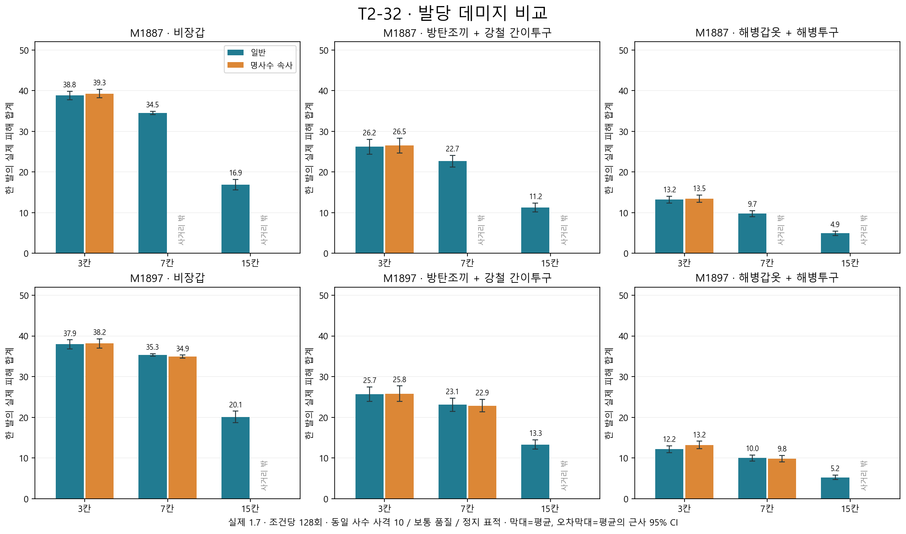
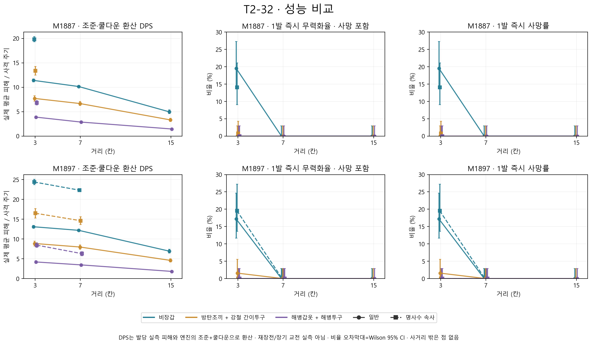

# T2-32 산탄 데미지·성능 차트

2026-11-03. 현재 커밋의 무기 수치 그대로 비교한 자료다. 제품 DLL·무기/탄약 정의·방어구/피해/발사 로직은 변경하지 않았다. T2-32의 수치 조정이나 완료 처리를 포함하지 않는다.

## 측정 조건과 해석

- 실제 RimWorld 1.7.4995 rev309, Main + 필수 Blancas/Harmony 및 기본 DLC. CE 없음.
- M1887·M1897, 일반·명사수 속사 모드, 거리 3·7·15칸, 비장갑·경방탄·중방탄. 사거리 안 27조건, 조건당 128발, 총 3,456발이다. 나머지 9조건은 사거리 밖이므로 0피해로 집계하지 않았다.
- 두 모드는 같은 사격 10레벨·명사수 유전자 사수로 비교한다. 보통 품질 무기, 건강한 25세 성인 인간 표적, 특성 없음·피해 배율 1·체격 1이다. 매 발 표적을 새로 만들고 사수 상태·좌표를 초기화한다. 엄폐·이동·기상·전술 조준·CQB 부위 선택은 사용하지 않는다.
- 경방탄은 보통 품질 **방탄조끼+강철 간이투구**다. 조끼가 팔·다리 전체를 덮는다고 가정하지 않는다. 중방탄은 보통 품질 **해병갑옷+해병투구**다. 실제 방어구와 부위별 판정을 통과시킨 결과이며, 갑옷을 전신 단일 방어율로 환산하지 않았다.
- 발당 피해는 실제 발사한 9펠릿이 네이티브 비행·충돌·장갑·내부 관통을 거쳐 표적 Pawn에 준 총피해다. 사망 뒤 시체 피해는 제외한다. 무력화율은 비행 종료 직후의 Downed 또는 Dead 비율이며 사망률을 포함한다. 지연 출혈·회복·치료 결과는 예측하지 않는다.
- **DPS는 환산값**이다. 실제 발당 평균 피해를 엔진에서 읽은 조준 시간+재사격 대기로 나눴다. 반복 발사는 각 발당 피해를 얻기 위해 대기 단계를 건너뛰어 호출하므로, 차트의 DPS는 장시간 AI 교전 실측과 구분한다. 비행 시간·재장전·이동·보급은 사격 주기에 추가하지 않는다.
- 평균 오차막대는 근사 95% 신뢰구간, 비율은 Wilson 95% 신뢰구간이다. 동일한 사수·표적 구성의 난수 표본이며, 모든 종족·사격 능력·품질·방어구에 대한 보장은 아니다.

## 현재 정의와 사격 주기

| 무기 | 모드 | 사거리 | 조준(초) | 쿨다운(초) | 주기(초) |
|---|---|---:|---:|---:|---:|
| M1887 | 일반 | 15.9 | 1 | 2.4 | 3.4 |
| M1887 | 명사수 속사 | 6.9 | 0.3 | 1.68 | 1.98 |
| M1897 | 일반 | 17.9 | 0.8 | 2.1 | 2.9 |
| M1897 | 명사수 속사 | 7.9 | 0.2 | 1.365 | 1.565 |

두 무기 모두 기본 펠릿 9개×피해 5·관통 8%다. 실제 피격 피해·관통은 산탄의 거리 에너지와 부위별 장갑을 적용한다. 기본 산포 σ는 M1887 1.0°·M1897 0.8°이며 모드별 기본 σ는 같지만 속사의 정확도 패널티가 조준 오차와 취급 산포에 반영된다.

## 비교 수치

**3칸·비장갑**

| 무기 | 모드 | 발당 평균 피해 | 평균 명중 펠릿 | 환산 DPS | 단발 사망 표본 |
|---|---|---:|---:|---:|---:|
| M1887 | 일반 | 38.80 | 8.89/9 | 11.41 | 25/128 |
| M1887 | 명사수 속사 | 39.26 | 8.93/9 | 19.83 | 18/128 |
| M1897 | 일반 | 37.94 | 8.84/9 | 13.08 | 22/128 |
| M1897 | 명사수 속사 | 38.16 | 8.84/9 | 24.38 | 25/128 |

**M1897·7칸**

| 표적 | 일반 피해 | 속사 피해 | 일반 환산 DPS | 속사 환산 DPS | 속사/일반 DPS |
|---|---:|---:|---:|---:|---:|
| 비장갑 | 35.32 | 34.93 | 12.18 | 22.32 | 1.83× |
| 방탄조끼+강철 간이투구 | 23.10 | 22.86 | 7.97 | 14.61 | 1.83× |
| 해병갑옷+해병투구 | 10.00 | 9.84 | 3.45 | 6.29 | 1.82× |

이 구성에서 M1897의 7칸 비장갑 발당 피해는 35.32→34.93으로 비슷하고, 환산 DPS는 12.18→22.32(약 1.83배)다. 이 차이는 주로 사격 주기 단축에서 나온다. M1887 속사는 사거리 6.9칸이므로 7칸·15칸에서는 사용할 수 없다. M1897 속사도 15칸에서는 사용할 수 없다.

7칸에서 사용할 수 있는 모든 표적·모드 조합에서는 비행 직후 무력화/사망이 각각 0/128회였다. 0회 표본의 Wilson 95% 상한은 약 2.91%이며 장기 출혈 또는 여러 발의 연속 피해를 포함하지 않는다.

## 데이터와 재현

성공한 실행 `.codex-staging/T2_32/actual-02`의 **3,456발·27 유효 조건×128회**만 집계했다. `status.txt`는 COMPLETE이며 발사 실패가 없다. 제품 기준 커밋은 `cf1856ec`다. 관측한 같은 펠릿의 양수 피해 호출 중복과 발당 피해 예산 초과는 모두 0회였다. 새로운 밸런스 값을 제안하거나 적용하지 않았다.

차트의 축·범례·주석·사거리 밖 표기를 렌더 후 확인했다. 측정 모듈 빌드 경고·오류 0개이며 성공 실행의 게임 ERROR는 기존 Workshop 3781143823 폴더 부재뿐이다. 이 자료는 사격 비교 분석이며 저장/불러오기 검증은 수행하지 않았다.

- [조건별 요약 CSV](Data/T2_32/summary.csv), [발당 원시 CSV](Data/T2_32/shots.csv), [실제 정의·방어구·정확도](Data/T2_32/specs.json), [실행 버전·해시](Data/T2_32/run.json).
- `Source/Analysis/T2_32/Start-Bench.ps1`가 기존 제품 DLL을 격리 호스트에 복사하고 관측 전용 모듈만 추가한다. `make_charts.py`가 완료한 36조건의 사용 가능 여부와 27조건의 동일 표본 수·9펠릿 수·피해 예산·중복 피해 호출을 대조한다.
- 자세한 호출과 시드·측정 한계는 [재현 README](../Source/Analysis/T2_32/README.md)에 있다.
